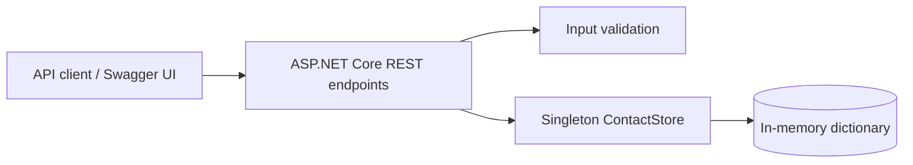

# Address Book REST API

SE4458 Assignment 2, Group 1. A deployable address book backend built with ASP.NET Core 9. It exposes interactive Swagger documentation at `/swagger` and stores contacts in process memory.

## Submission links

| Item | URL |
| --- | --- |
| Source code | https://github.com/MuhammetDemir0/se4458-address-book-api |
| Live Swagger | https://se4458-address-book-api-bqmi.onrender.com/swagger |

Both links point to the published project.

## Features

- Create, read, fully update, and delete contacts.
- Search by name, email, phone, or city without regard to letter case.
- Sort by name, creation time, or update time, ascending or descending.
- Filter favorites and set favorite state through a dedicated `PATCH` endpoint.
- Paginate results with a maximum page size of 100.
- Validate input and return standard HTTP problem responses.
- Explore and execute every operation from Swagger UI.

## API contract

Base path: `/api/v1/contacts`

| Method | Path | Purpose | Success |
| --- | --- | --- | --- |
| GET | `/api/v1/contacts` | List, search, sort, filter, paginate | `200` |
| POST | `/api/v1/contacts` | Create | `201` and `Location` |
| GET | `/api/v1/contacts/{id}` | Read one | `200` |
| PUT | `/api/v1/contacts/{id}` | Replace all editable fields | `200` |
| PATCH | `/api/v1/contacts/{id}/favorite` | Set favorite state | `200` |
| DELETE | `/api/v1/contacts/{id}` | Delete | `204` |
| GET | `/health` | Deployment health check | `200` |
| GET | `/openapi.json` | OpenAPI 3 contract | `200` |
| GET | `/swagger` | Interactive API documentation | `200` |

`GET /api/v1/contacts` accepts `search`, `favorite`, `sortBy=name|createdAt|updatedAt`, `order=asc|desc`, `page` (from 1), and `pageSize` (1–100). Defaults are name ascending, page 1, and page size 20. The response contains `items`, `total`, `page`, and `pageSize`.

Example create request:

```json
{
  "name": "Ada Lovelace",
  "email": "ada@example.com",
  "phone": "+90 555 123 4567",
  "address": {
    "street": "1 Example Street",
    "city": "Izmir",
    "country": "Turkey",
    "postalCode": "35000"
  },
  "notes": "Classmate",
  "isFavorite": false
}
```

## Run locally

Requirements: .NET 9 SDK. From this directory:

```bash
dotnet run --urls http://localhost:8080
```

Open `http://localhost:8080/swagger`. Swagger UI loads its JavaScript and CSS from the public `swagger-ui-dist` CDN; the API and OpenAPI contract are served by this application.

Run the end-to-end smoke test after building (Python 3 required):

```bash
dotnet build -c Release
python tests/smoke.py
```

## Deploy on Render

1. Push this directory to a GitHub repository, keeping `Dockerfile` and `render.yaml` at the repository root.
2. In Render, choose **New > Blueprint**, connect that repository, and apply `render.yaml`.
3. Wait for the `/health` check to pass. Open the live Swagger URL above and create a contact using **Try it out**.

The Dockerfile also works on any Docker hosting service. The container listens on port 8080. No database service or secret is required.

## Design and assumptions



- The assignment specifies in-memory storage, so one singleton store owns the contact collection. A lock protects reads and writes from simultaneous requests.
- A contact is identified by a server-generated UUID. `createdAt` and `updatedAt` use UTC.
- `PUT` replaces every editable field. `PATCH /favorite` sets an explicit boolean; repeating the same request leaves the favorite state the same.
- Search uses a case-insensitive substring match. Pagination is applied after filtering and sorting, and `total` counts all matches before pagination.
- A missing contact returns `404`; invalid input or query options return `400`. Creation returns `201` with a `Location` header. Deletion returns `204`.
- The `/api/v1` prefix makes the public contract explicit if a later incompatible version is introduced.
- The API is public and does not handle private user accounts; authentication and authorization were not required for this assignment. Do not store real personal data in this demonstration service.

## Issues and limitations

- In-memory data disappears when the process restarts, a free host sleeps/restarts, or a new version is deployed. This follows the assignment's storage constraint.
- Multiple service instances would each have separate data. A production address book would need a shared persistent database and access control.
- Swagger UI assets come from a CDN. If that CDN is blocked, `/openapi.json` remains accessible, but the interactive page may not load.
- The smoke test checks the OpenAPI endpoint, create/read/update/delete, search, sort, pagination, favorites, and validation. It does not claim load or security testing.
